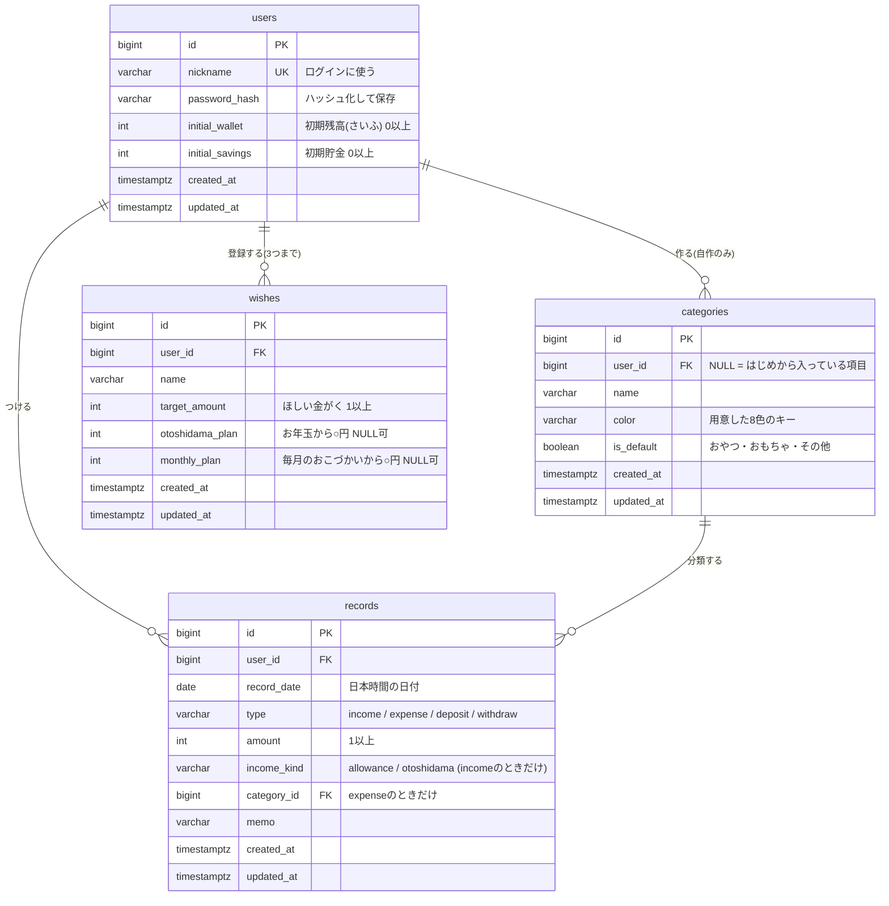

# ER図: こどもマネー日記

| 項目 | 内容 |
|---|---|
| 版 | 0.1(たたき台) |
| 元にする文書 | `requirements.md` 0.3 / `docs/screens.md` 0.1 |
| DB | PostgreSQL |

## 1. ER図



## 2. テーブルの説明

### users
- ニックネームとパスワードだけ持つ(メールアドレス・本名は持たない)。
- `initial_wallet` と `initial_savings` は、収入や貯金の記録には数えない(要件 9-7)。

### categories(支出の項目)
- はじめから入っている「おやつ」「おもちゃ」「その他」は `user_id = NULL`、`is_default = true` で、全員が共通で使う。直せない・消せない。
- 自作の項目は `user_id` を持つ。名前と色を直せる、消せる。
- 色は、用意した 8 色のキー(例: `red1`)を入れる。実際の色の値は、フロントの CSS の変数にまとめる。
- 自作の項目を消すとき、使われている記録は、先に「その他」へ移す(アプリ側の処理)。

### records(記録)
画面の「なにを した?」4 つを、`type` で分ける。**1 件の記録 = 1 つの種類**にする。

| type | 画面の言葉 | さいふ | 貯金 | 使う欄 |
|---|---|---|---|---|
| income | もらった | ＋ | | `income_kind` |
| expense | つかった | − | | `category_id` |
| deposit | 貯金へ入れた | − | ＋ | |
| withdraw | 貯金からだした | ＋ | − | |

### wishes(ほしいもの)
- 3 つまでは、アプリ側のチェックで守る(DB の制約では書きにくいため)。
- 進み具合の計算で、「作った順」に貯金をあてるので、`created_at` の順で並べる。

## 3. 計算する値(DBには持たない)

残額と貯金額は、保存せず、そのつど記録から計算する。直した・消したときに、数字がずれないようにするため。

```
さいふ = initial_wallet + Σ income − Σ expense − Σ deposit + Σ withdraw
貯金   = initial_savings + Σ deposit − Σ withdraw
```

月のまとめは、`record_date` の範囲(1 日〜月末)で `GROUP BY type, income_kind, category_id` して出す。

## 4. 制約とインデックス

| 対象 | 内容 |
|---|---|
| users.nickname | UNIQUE |
| users.initial_wallet / initial_savings | CHECK >= 0 |
| records.amount | CHECK > 0(0 円と空の記録を作れない。KM-09) |
| records.type | CHECK IN ('income','expense','deposit','withdraw') |
| records.income_kind | type = 'income' のときだけ必須。それ以外は NULL(CHECK) |
| records.category_id | type = 'expense' のときだけ必須。それ以外は NULL(CHECK) |
| records.record_date | 未来の日付は、アプリ側で止める |
| wishes.target_amount | CHECK > 0 |
| wishes.otoshidama_plan / monthly_plan | CHECK >= 0(NULL 可) |
| categories (user_id, name) | UNIQUE(同じ人が、同じ名前を 2 つ作れない) |
| records (user_id, record_date DESC, id DESC) | INDEX(一覧を新しい順に 1 秒以内で出す) |
| 外部キー | records.user_id、wishes.user_id、categories.user_id は ON DELETE CASCADE。records.category_id は ON DELETE RESTRICT(「その他」へ移してから消す) |

## 5. 決めたこと・まだ決めないこと

**この案で決めたこと**
- 1 件の記録は 1 つの種類だけ持つ(画面の案 S4 に合わせる)。要件 KM-04 の「収入と支出を同時に入れる」形は使わない。
- 残額と貯金額は、保存せずに計算する。
- はじめから入っている項目は、全員で共通の行にする(ユーザーごとにコピーしない)。

**まだ決めないこと(実装のときに決める)**
- 「その他」へ移す処理を、アプリ側にするか、DB のトリガーにするか(今はアプリ側の案)。
- ユーザーを消す機能(最小版では作らない。CASCADE だけ用意する)。
- 金額の上限(`int` で足りるが、入力の上限を決めるか)。
